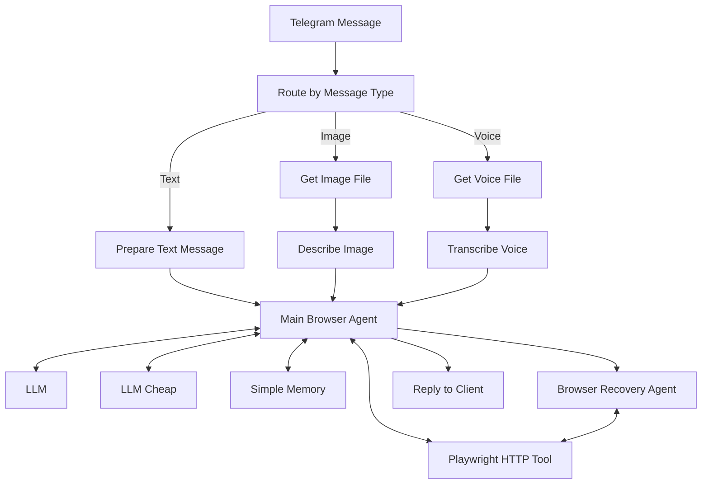
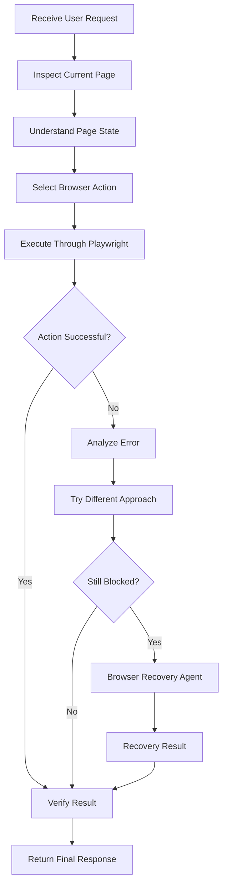

<div align="center">

# 🚀 n8n Playwright Browser Automation Bridge

### AI-Powered Browser Automation with n8n, Playwright & LLM Agents

An intelligent browser automation system that connects AI agents to a real Brave browser through a Playwright HTTP API, enabling automated browsing, page interaction, information extraction, and intelligent error recovery.

<br>


</div>

---

## 📸 Workflow Overview

The following screenshot shows the complete n8n automation architecture.

<div align="center">


</div>

---

## 📌 Project Overview

**n8n Playwright Browser Automation Bridge** is an AI-powered automation system designed to control a real Brave browser using natural language instructions.

The system combines n8n workflows, LLM-powered agents, and Playwright browser automation to execute browser tasks, inspect web pages, interact with elements, extract information, and recover from execution errors.

Users can interact with the system through Telegram using text, images, or voice messages.

### 🎯 Main Objectives

- Automate real browser interactions using AI agents.
- Execute browser actions through a Playwright HTTP API.
- Understand text, image, and voice instructions.
- Inspect web pages before performing actions.
- Extract relevant information from websites.
- Recover from browser execution failures.
- Verify important actions before reporting success.

---

## ✨ Key Features

| Feature | Description |
|---|---|
| 🤖 AI Browser Agent | Understands natural language instructions and plans browser actions. |
| 🌐 Real Browser Control | Controls a real Brave browser through Playwright. |
| 💬 Telegram Integration | Receives user instructions and returns results. |
| 🖼️ Image Understanding | Processes images using an AI vision model. |
| 🎙️ Voice Transcription | Converts voice messages into text. |
| 🔄 Error Recovery | Uses a dedicated Browser Recovery Agent. |
| 🧠 Conversational Memory | Maintains relevant conversation context. |
| 🔍 Page Inspection | Inspects the current browser page before acting. |
| 📄 Information Extraction | Extracts specific information from websites. |
| ✅ Action Verification | Verifies important browser actions before reporting success. |

---

## 🏗️ System Architecture

The system is organized around a Main Browser Agent connected to browser automation tools, language models, memory, and a recovery agent.

### Architecture Diagram



### Core Components

| Component | Responsibility |
|---|---|
| Receive Client Message | Receives incoming Telegram messages. |
| Route by Message Type | Routes messages according to their type. |
| Prepare Text Message | Prepares text instructions for the main agent. |
| Get Image File | Downloads incoming image attachments. |
| Describe Image | Analyzes images using an AI model. |
| Get Voice File | Downloads incoming voice messages. |
| Transcribe Voice | Converts voice messages into text. |
| Main Browser Agent | Understands requests and coordinates browser execution. |
| Playwright | Provides browser automation capabilities. |
| LLM | Processes instructions and supports agent reasoning. |
| LLM Cheap | Provides an alternative language model. |
| Simple Memory | Maintains conversational context. |
| Browser Recovery Agent | Handles failed or blocked browser operations. |
| Reply to Client | Returns the final response to the user. |

---

## 🔄 Browser Automation Lifecycle

The browser agent follows a structured execution process.



### Execution Principles

1. Inspect the current page before acting.
2. Identify relevant elements before interacting with them.
3. Prefer currently visible content when the user asks to open something already displayed.
4. Use search only when explicitly requested or when no matching visible content exists.
5. Never repeat an identical failed action without changing the approach.
6. Verify important actions before reporting success.
7. Delegate unresolved failures to Browser Recovery Agent.
8. Always return a final response, even if execution fails.

---

## 🌐 Playwright HTTP API

The browser agent communicates with the Playwright service through an HTTP Request tool.

### API Configuration

| Parameter | Configuration |
|---|---|
| HTTP Method | `POST` |
| Endpoint | `/execute` |
| Content Type | `application/json` |
| Authentication | API Key |
| API Key Header | `x-api-key` |
| Browser | Brave |
| Automation Engine | Playwright |

### Endpoint

```text
http://host.docker.internal:3000/execute
```

### Example Request

The API accepts an array of browser actions.

```json
{
  "actions": [
    {
      "type": "navigate",
      "url": "https://www.youtube.com"
    }
  ]
}
```

### Example: Navigate and Inspect

```json
{
  "actions": [
    {
      "type": "navigate",
      "url": "https://www.youtube.com"
    },
    {
      "type": "inspectPage"
    }
  ]
}
```

> The exact action parameters depend on the installed Playwright bridge implementation.

### cURL Example

```bash
curl -X POST "http://localhost:3000/execute" \
  -H "Content-Type: application/json" \
  -H "x-api-key: YOUR_API_KEY" \
  -d '{
    "actions": [
      {
        "type": "navigate",
        "url": "https://www.youtube.com"
      }
    ]
  }'
```

Replace `YOUR_API_KEY` with your configured API key.

**Security:** Never expose API keys or authentication credentials in public repositories.

---

## 🧰 Supported Browser Actions

The current browser tool description includes the following actions:

| Action | Function |
|---|---|
| `navigate` | Navigate to a specified URL. |
| `click` | Click an element. |
| `fill` | Enter text into an input field. |
| `press` | Press a keyboard key. |
| `scroll` | Scroll the current page. |
| `hover` | Hover over an element. |
| `select` | Select an option. |
| `wait` | Wait for a specified duration. |
| `waitFor` | Wait for an element or condition. |
| `extract` | Extract requested page information. |
| `evaluate` | Evaluate a supported browser expression. |
| `inspectPage` | Inspect the current page. |
| `getPageState` | Retrieve the current page state. |
| `screenshot` | Capture a browser screenshot. |
| `newTab` | Open a new browser tab. |
| `switchTab` | Switch between browser tabs. |
| `closeTab` | Close a browser tab. |
| `back` | Navigate to the previous page. |
| `forward` | Navigate to the next page. |
| `reload` | Reload the current page. |

---

## 🛡️ Intelligent Error Recovery

The project includes a dedicated **Browser Recovery Agent** connected to the main browser agent.

Its purpose is to handle situations where the main agent cannot complete a browser task.

### Recovery Process

- Receive the original task.
- Analyze the current page state.
- Read the browser execution error.
- Identify an alternative approach.
- Continue browser execution.
- Return the recovery result to the main agent.

### Important Rules

- Never repeat the same failed action blindly.
- Use the error details to determine the next action.
- Do not claim success without verification.
- Ask the user to complete sensitive steps manually.

---

## 🧠 AI Agent Strategy

The Main Browser Agent coordinates the browser tools and language models.

| Agent / Component | Role |
|---|---|
| Main Browser Agent | Main reasoning and task execution. |
| Browser Recovery Agent | Alternative execution and error recovery. |
| LLM | Main language model. |
| LLM Cheap | Alternative language model. |
| Simple Memory | Conversational context. |
| Playwright | Browser interaction tool. |

### Example User Instructions

| User Request | Expected Behavior |
|---|---|
| Open YouTube. | Navigate to YouTube. |
| Open a PSG video from the homepage. | Inspect visible videos and open a matching one. |
| Search for Python tutorials. | Use the website search functionality. |
| Extract the page title. | Extract the requested title. |
| Click the login button. | Inspect the page and interact with the matching button. |

---

## ⚙️ Installation & Configuration

### Requirements

- n8n instance.
- Telegram Bot credentials.
- Configured LLM provider.
- Playwright HTTP automation service.
- Brave browser accessible to the Playwright service.
- Network connectivity between n8n and the browser service.

### Configuration Checklist

| Configuration | Required |
|---|---|
| Telegram Credentials | Yes |
| LLM Credentials | Yes |
| Playwright HTTP Endpoint | Yes |
| Playwright API Key | Yes |
| Brave Browser | Yes |
| Simple Memory | Optional, depending on configuration |
| Browser Recovery Agent | Recommended |

### Docker Networking

When n8n runs inside Docker and the Playwright service runs on the host, the endpoint may use:

```text
http://host.docker.internal:3000/execute
```

The hostname depends on the deployment environment and Docker networking configuration.

---

## 📁 Project Structure

```text
n8n-playwright-browser-automation-bridge/
│
├── README.md
│
├── docs/
│   └── images/
│       └── workflow-overview.png
│
└── ...
```

---

## 🔐 Security Considerations

- Store API keys securely.
- Never commit Telegram bot tokens.
- Do not publish browser cookies or session data.
- Protect sensitive information in execution logs.
- Ask for manual user intervention during login, CAPTCHA, and OTP verification.
- Use secure credentials management in n8n.

---

## 🚀 Future Improvements

Potential improvements for future versions:

- More efficient browser response filtering.
- Better token usage optimization.
- Improved browser state inspection.
- Advanced retry and recovery strategies.
- Support for additional browser automation tasks.
- Better execution monitoring and logging.
- More structured browser action responses.

---

## 📊 Project Information

| Property | Value |
|---|---|
| Project | n8n Playwright Browser Automation Bridge |
| Category | AI Automation |
| Workflow Engine | n8n |
| Browser Automation | Playwright |
| Browser | Brave |
| Communication | HTTP API |
| User Interface | Telegram |
| Intelligence | LLM-based AI Agents |
| Recovery | Browser Recovery Agent |

---

## 🤝 Contributing

Contributions, suggestions, and bug reports are welcome.

When reporting an issue, include:

- The browser action that failed.
- The error returned by the API.
- Relevant page state.
- Expected behavior.

Remove credentials and private information before sharing logs or screenshots.

---

## 📄 License

No license has been specified yet.

Add a `LICENSE` file to define the permissions for using, modifying, and distributing this project.

---

<div align="center">

### Built with n8n, Playwright & AI Agents

**Automating the browser. One intelligent action at a time.**

</div>
