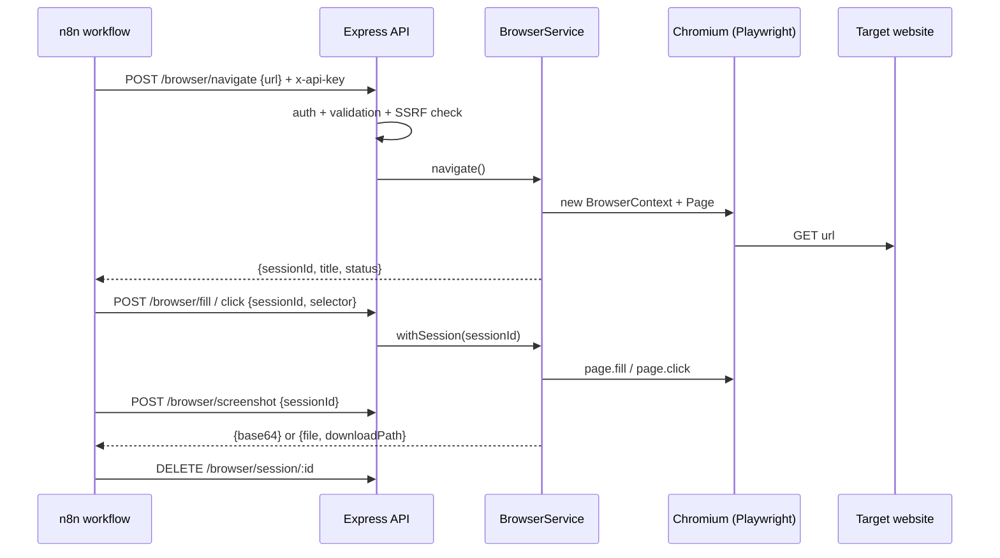

# Architecture

## Layers

| Layer | File | Responsibility |
| --- | --- | --- |
| Entry point | `src/server.js` | Builds the Express app, loads config, error handling, graceful shutdown |
| Auth | `src/middleware/auth.js` | API key check with constant-time comparison |
| Routes | `src/routes/browser.routes.js` | HTTP mapping only: validate, call service, return JSON |
| Service | `src/services/browser.service.js` | One shared Chromium, isolated sessions, TTL cleanup, Playwright calls |
| Utils | `src/utils/validation.js` | Request body validation and SSRF guard |

## Sessions

n8n talks HTTP, and every HTTP call is stateless, but a browser task is stateful (open page, then fill, then click).
The bridge solves this with **sessions**: `/browser/navigate` without a `sessionId` creates a new isolated
`BrowserContext` (own cookies, storage, page) and returns its id. Later calls pass that id.

- Calls on the same session are queued, so two parallel n8n branches cannot interleave actions.
- Sessions expire after `SESSION_TTL_MS` of inactivity and are limited by `MAX_SESSIONS`.
- Closing a session (`DELETE /browser/session/:id`) frees memory immediately.

## Security model

1. **API key** on everything under `/browser`. The server refuses to start without one.
2. **SSRF guard**: only `http(s)`; hostnames are resolved and rejected if they point to loopback, private,
   link-local (cloud metadata) or reserved ranges.
3. **Request interception**: the same check runs on *every* request the page makes, so a public site that
   redirects to `http://169.254.169.254/` is blocked too.
4. **Optional allow-list** (`ALLOWED_DOMAINS`) for top-level navigation.
5. **Resource limits**: session cap, idle TTL, per-action timeouts (max 60 s), 10 MB body limit, 5 MB uploads.
6. **Isolation**: each session is a separate browser context; downloads and service workers are disabled.

### Known limitations

- DNS rebinding between the check and the browser's own resolution is mitigated (not eliminated) by the
  per-request interception. For hostile environments, put the container behind an egress firewall.
- There is no rate limiting; put the API behind a reverse proxy (Caddy, nginx, Traefik) if it is exposed.
- Selectors are passed straight to Playwright, so anyone with the API key can run any selector on any allowed page.
  Treat the API key like a password.
